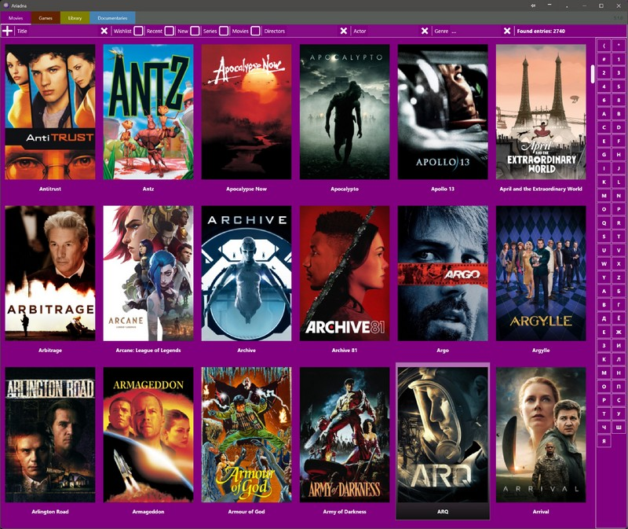

# Ariadna

A personal Windows media catalog built with .NET 10 WPF and SQLite.
WPF is the sole application; the retired WinForms frontend and migration utility
are no longer part of this repository.

## Features

- Five permanent tabs: Movies, Games, Library, Documentaries.
- Poster browsing, collection-specific filters and retained tab state.
- Native metadata editors, shared person portraits.
- TMDb metadata lookup, MediaInfo inspection, discovery and ignore lists.
- Configured media player and file-manager integration.


## Requirements and configuration

Windows 10+ (x64) and .NET 10 are required for framework-dependent runs.
Development uses SDK 10.0.401 or a newer 10.0.4xx patch as selected by `global.json`;
preview SDKs are excluded. A self-contained publish includes the runtime.

Configure the existing SQLite catalog, image folders, media roots, external tools and TMDb API key in `Ariadna/App.config`.
See [SQLite operations](docs/SQLITE-OPERATIONS.md) for disposable overrides and matched database/image recovery.

## Build, test and publish

Dependencies use checked-in NuGet lock files.

```powershell
dotnet restore Ariadna.slnx --locked-mode
dotnet build Ariadna.slnx -c Release --no-restore
dotnet test Ariadna.slnx -c Release --no-build --no-restore
dotnet publish Ariadna/Ariadna.csproj -c Release -r win-x64 --self-contained true --no-restore -o publish
```

Automated tests run headlessly. WPF layout checks use detached visual trees on an STA dispatcher.

Run `Ariadna.exe`.
A second launch activates the existing instance.
Ctrl+Tab / Ctrl+Shift+Tab cycle tabs; Ctrl+1 through Ctrl+5 select them directly
in the order above. Switching waits for an open modal editor to close.

## Documentation

- [Technical Design Description](docs/Technical_Design_Description.md): architecture and workflow contracts.
- [SQLite operations](docs/SQLITE-OPERATIONS.md): storage, configuration and recovery.
- [Changelog](CHANGELOG.md): implementation and version history, including retired projects.
- [Plan](docs/PLAN.md): user-maintained upcoming work.
- [Agent instructions](AGENTS.md) and [memory](MEMORY.md): contributor rules and historical handoff.
