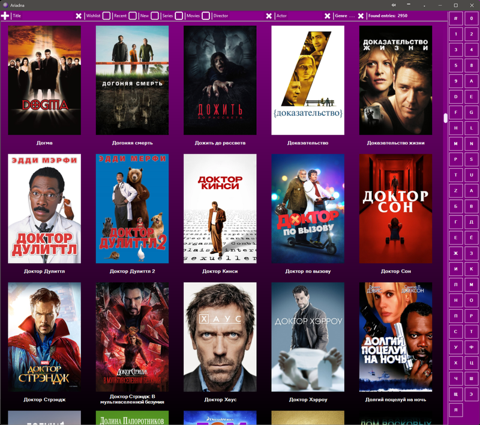

# Ariadna

A personal Windows media catalog built with .NET 10 WPF and SQLite.
WPF is the sole application; the retired WinForms frontend and migration utility
are no longer part of this repository.

## Features

- Five permanent tabs: Movies, Games, Library, Documentaries and XXX.
- Poster browsing, collection-specific filters and retained tab state.
- Native metadata editors, shared person portraits, game previews and XXX screenshots.
- TMDb metadata lookup, MediaInfo inspection, discovery and ignore lists.
- Configured media player and file-manager integration.


## Requirements and configuration

Windows 10+ (x64) and .NET 10 are required for framework-dependent runs.
Development uses SDK 10.0.401 or a newer 10.0.4xx patch as selected by `global.json`;
preview SDKs are excluded. A self-contained publish includes the runtime.

Configure the existing SQLite catalog, image folders, media roots, external tools
and TMDb API key in `Ariadna/App.config`. Keep private values out of reports.
Startup refuses a missing catalog instead of silently creating an empty one.
See [SQLite operations](docs/SQLITE-OPERATIONS.md) for disposable overrides and
matched database/image recovery.

## Build, test and publish

Open `Ariadna.slnx` in Visual Studio 2026 or an editor with SLNX support and select
`Ariadna` as the startup project. The solution contains the application,
storage library and their two test projects. Close running instances before rebuilding.
Dependencies use checked-in NuGet lock files.

```powershell
dotnet restore Ariadna.slnx --locked-mode
dotnet build Ariadna.slnx -c Release --no-restore
dotnet test Ariadna.slnx -c Release --no-build --no-restore
dotnet publish Ariadna/Ariadna.csproj -c Release -r win-x64 --self-contained true --no-restore -o publish
```

Automated tests run headlessly. WPF layout checks use detached visual trees on
an STA dispatcher; tests must not show or activate windows, open native popups
or dialogs, or read/write the desktop clipboard. The harness checks that no
native presentation sources or application window handles remain; a source-policy
test also rejects direct desktop-interaction calls. Model and
real-provider tests retain synthetic, disposable catalogs. Native focus, modal
interaction, capture and rendered-frame behavior require separate manual checks.

Run `Ariadna/bin/Release/net10.0-windows8.0/Ariadna.exe`.
No argument opens Movies; `movies`, `games`, `library`, `documentaries` and `xxx`
select an initial tab. A second launch activates the existing instance.
Ctrl+Tab / Ctrl+Shift+Tab cycle tabs; Ctrl+1 through Ctrl+5 select them directly
in the order above. Switching waits for an open modal editor to close.

XXX uses `DefaultXxxPath`, `DefaultXxxPathVR` and `XxxPostersRootPath`;
an empty poster root defaults to `xxx` beside the database. Include it in backups.

## Documentation

- [Technical Design Description](docs/Technical_Design_Description.md): architecture and workflow contracts.
- [SQLite operations](docs/SQLITE-OPERATIONS.md): storage, configuration and recovery.
- [Changelog](CHANGELOG.md): implementation and version history, including retired projects.
- [Plan](docs/PLAN.md): user-maintained upcoming work.
- [Agent instructions](AGENTS.md) and [memory](MEMORY.md): contributor rules and historical handoff.

The user confirmed WPF stability and acceptance on 2026-11-02. Historical memory
and changelog entries retain their original dates and verification limits.
